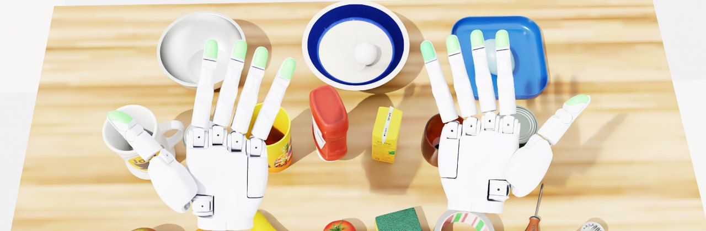

# egohand-live

**Teleoperate robot hands in Isaac Sim with one desk camera instead of a VR headset.**

egohand-live runs NVIDIA's [EgoHand](https://github.com/NVIDIA/IsaacCapture/tree/main/src/python/isaaccapture_egopost)
hand-pose model live on a camera stream and publishes both hands in 3D in the OpenXR hand-joint
format that headset hand tracking uses. Included Isaac Sim / Isaac Lab scenes retarget them to
Sharpa Wave robot hands, either free-floating or mounted on a Franka FR3 Duo, or drive a
parallel-jaw gripper in Isaac Lab's manipulation tasks and record demonstrations, so the robot
follows your hands.

| Sharpa Wave hands on a Franka FR3 Duo | Free-floating Sharpa Wave hands |
| --- | --- |
|  |  |

<!-- demo video: real hands next to the simulator -->

## Why

Teleoperating robot hands, for instance to collect demonstrations for robot learning, usually
requires a hand-tracking headset (Apple Vision Pro, Meta Quest) or data gloves. egohand-live
needs a camera on a desk stand and runs on the kind of NVIDIA GPU you already use for Isaac Sim:
tracking and simulation run in real time together on one RTX 3080 Ti laptop.

- **Nothing to wear.** Sit down and move your hands over the desk; the camera can record the
  human view at the same time.
- **Low cost.** A cheap UVC webcam (tested) or an Intel RealSense D405 (tested), on a stand of
  printed parts, a 20 × 20 mm aluminium extrusion and standard screws. A printed calibration board
  sets up the lens, the camera pose and the depth scale in a few minutes.
- **Drop-in data.** The output follows the OpenXR hand-joint convention; finger retargeting uses
  the same DexPilot setup as NVIDIA Isaac Teleop's headset pipeline, and gripper control the same
  pinch rule as its manipulator retargeters. Demonstrations are saved in Isaac Lab's HDF5 format.

Why one fixed camera works: EgoHand is trained on head-mounted (egocentric) video, so the
[desk stand](hardware/d405_desk_mount) puts the camera where your head would be, behind and
above your hands.

|  | Hand-tracking headset | egohand-live |
| --- | --- | --- |
| Hardware | €330 – €4,000 headset | webcam or D405 + printed stand, on the GPU that runs Isaac Sim |
| Operator | wears the headset | nothing to wear |
| View of the robot | immersive stereo | monitor |
| Hand pose | measured by the headset's cameras | estimated from one image: good finger shapes; absolute depth calibrated to a few % |
| Compute | in the headset | RTX-class GPU; tracking + Isaac Sim in real time on one RTX 3080 Ti laptop |

## How it works

```
camera ──► RT-DETR hand detector ──► L/R hand tracker ──► EgoHand (DINOv3 ViT-H+) ──► smoothing
                                                                                        │
     Isaac Sim / Isaac Lab ◄── robot hands / arm + gripper ◄── retargeting ◄── OpenXR-26 hand joints (ZMQ)
```

EgoHand ships as an offline video pipeline (video in, poses out). egohand-live wraps it for live
use without modifying it: a causal hand tracker, per-frame inference of both hands (fp16, CUDA
graphs), online smoothing, and a ZeroMQ stream that other processes (the simulator, a viewer,
your own code) subscribe to. Details: [docs/tracking.md](docs/tracking.md) and
[docs/isaac_sim.md](docs/isaac_sim.md).

## Quick start

Tested on Ubuntu 24.04, Python 3.12, NVIDIA driver 595 (CUDA 13), Isaac Sim 6.2 / Isaac Lab 3.0,
on an RTX 3080 Ti laptop (everything on one machine) and with an RTX 5090 for tracking.

**1. Install hand tracking**

```bash
git clone https://github.com/timfmartin/egohand-live && cd egohand-live
bash scripts/setup.sh                     # pinned upstream EgoHand + dependencies + models (~12 GB)
source .venv/bin/activate
egohand-live slim-ckpt --out checkpoints/egohand_slim.ckpt   # optional: 3.5 GB instead of 10.7 GB, loads faster
```

**2. Set up the camera** (once per camera and placement; see [docs/tracking.md](docs/tracking.md#webcam-setup))

```bash
egohand-live preview --source webcam:0                        # aim the camera: work area in the middle
egohand-live calibrate-camera --source webcam:0 --board charuco:auto:27 --out outputs/cam.json   # lens
egohand-live calibrate-desk-board --source webcam:0 --intrinsics outputs/cam.json \
    --board charuco:auto:27 --out outputs/T_world_camera.txt  # camera pose: board flat on the desk
```

A RealSense needs no lens calibration (`--source realsense`). Any printed ChArUco board works
(27 = square size in mm), as does a checkerboard on a phone screen.

**3. Track**

```bash
egohand-live run --source webcam:0 --intrinsics outputs/cam.json --extrinsics outputs/T_world_camera.txt \
    --checkpoint checkpoints/egohand_slim.ckpt --compile --show --publish
egohand-live calibrate-depth --extrinsics outputs/T_world_camera.txt   # optional: measure --depth-scale
```

**4. Robots in Isaac Sim** (same or another machine)

```bash
bash scripts/setup_isaac.sh               # Sharpa Wave models (pinned) + two small packages for Isaac Sim's Python
python3 scripts/fetch_simready.py         # desk props + Franka FR3 Duo (CC-BY-4.0, ~375 MB)
~/isaacsim/python.sh isaac/sharpa_hands.py --extrinsics outputs/T_world_camera.txt               # Sharpa hands
~/isaacsim/python.sh isaac/sharpa_hands.py --extrinsics outputs/T_world_camera.txt --rig franka  # on an FR3 Duo
~/isaacsim/python.sh isaac/arm_teleop.py --extrinsics outputs/T_world_camera.txt                 # Franka gripper, cube stacking
```

Add `--connect tcp://TRACKING_HOST:5555` when tracking runs elsewhere. The viewport renders in a
light mode by default so tracking keeps the GPU; `--render quality` gives full RTX for videos.

**No camera?** `egohand-live synthetic --publish "tcp://*:5555"` streams moving, grasping
synthetic hands in the same format, enough to try the simulator side.

## Grippers and demonstrations

[`isaac/arm_teleop.py`](isaac/arm_teleop.py) drives Isaac Lab tasks with an end-effector pose
action and a gripper (default `IsaacContrib-Stack-Cube-Franka-IK-Abs`): the gripper follows the
point between your thumb and index fingertips, and pinching closes it (`--gripper continuous`
makes the opening follow the pinch width). `--record demos/stack.hdf5` saves successful episodes
with Isaac Lab's recorder, ready for `replay_demos.py` and GR00T-Mimic.

## Demo videos

`egohand-live run ... --save-session DIR` records the frames with everything computed per frame;
`egohand-live render-video DIR` renders a video that builds up the pipeline step by step (camera,
hand tracking, 3D hand pose, hand model), with 16:9, 1:1 and 9:16 output. New and still
evolving: a robot-hand overlay and the simulator view are next.

## Hardware

The [D405 desk stand](hardware/d405_desk_mount) holds the camera on an 880 mm aluminium extrusion
clamped to the desk edge, with an adjustable tilt. Four printed parts, standard M3/M4/M5 screws.
FreeCAD source, STEP and STL files are included; `mount_geometry.py` turns the collar height and
tilt reading into the camera pose for the simulator. A webcam can sit on the same stand.

## Results

| Measurement | Value |
| --- | --- |
| Tracking, RTX 3080 Ti laptop (1–2 hands, fp16, CUDA graphs) | 70 ms per frame (~14 FPS); 58–63 ms with `--compile` (~16 FPS) |
| Same, with Isaac Sim (Sharpa hands, light rendering) on the same GPU | tracking 40–50 ms per frame for one hand, sim at 1.0× real time, ~65 ms camera → robot hand |
| Tracking, RTX 5090 (two hands, bf16, `--compile`, earlier version) | ~22 FPS; 50 ms capture → poses |
| fp16 path vs. fp32 reference | 0.3–0.4 mm mean joint difference (bf16: 1.3 mm) |
| Webcam at ~0.9 m: monocular depth before / after `--depth-scale` | −13 % ± 3 % / within a few % |
| Retargeting (DexPilot, Sharpa Wave, 22 DoF) | 5–15 ms per hand |
| Robot vs. tracked fingertips | 1–4 cm |
| Arm IK error while following (FR3 Duo; Franka gripper task, synthetic hands) | 5–20 mm |

## Limitations

- Needs an RTX-class GPU. On a laptop, the GPU (and CPU) is shared with Isaac Sim, so keep other
  heavy jobs off while teleoperating.
- Monocular depth: finger shapes are good; the absolute distance has a camera-specific bias that
  `calibrate-depth` corrects. Beyond ~1 m from the camera the error becomes random (about ±12 % at
  1.2 m), so keep the camera within ~0.9 m of your hands.
- The viewpoint matters: the camera should look over your shoulders at your hands. Left and right
  are assigned by image position, which assumes this placement.
- A monitor instead of an immersive view; no force or haptic feedback.

## Roadmap

- Demo videos with the robot hand overlaid on the camera view, next to the simulator.
- A browser setup app: pick a camera, calibrate, choose teleoperation or data collection.
- More Isaac Lab tasks (SO-101, humanoids) and LeRobot export for VLA training.
- Fuse the D405's depth for absolute wrist position.
- A humanoid rig (Unitree H2 with Sharpa hands).

## Repository layout

```
egohand_live/     live tracking, protocol, retargeting, calibration, gripper teleop math,
                  session recording and videos, synthetic hands (CLI: egohand-live)
isaac/            Isaac Sim scenes: Sharpa hands, FR3 Duo rig, Isaac Lab gripper teleop, render presets
hardware/         3D-printable D405 desk stand (FreeCAD, STEP, STL)
configs/          DexPilot retargeting configs (from NVIDIA IsaacCapture)
scripts/          setup, asset download, upstream verification
tests/            GPU-free tests (run in CI)
docs/             tracking and Isaac Sim details
```

## Credits and licenses

- Code in this repository: [Apache-2.0](LICENSE).
- EgoHand / EgoPost and its model weights: NVIDIA,
  [OpenMDW-1.1](https://github.com/NVIDIA/IsaacCapture/blob/main/LICENSES/LicenseRef-OpenMDW-1.1.txt),
  part of [NVIDIA Isaac Capture](https://github.com/NVIDIA/IsaacCapture). Downloaded at a pinned
  commit by `scripts/setup.sh`, not redistributed.
- `configs/retarget/*.yml`: from NVIDIA Isaac Capture (Apache-2.0, © The Isaac Lab Project
  Developers). Retargeting uses [dex-retargeting](https://github.com/dexsuite/dex-retargeting).
- Sharpa Wave hand models: [Sharpa](https://github.com/sharpa-robotics/sharpa-urdf-usd-xml),
  downloaded at a pinned commit by `scripts/setup_isaac.sh`, not redistributed.
- Desk props: [NVIDIA SimReady assets](https://huggingface.co/datasets/nvidia/simready-assets);
  Franka FR3 Duo: [Franka Robotics SimReady assets](https://huggingface.co/datasets/frankarobotics/simready-assets).
  Both CC-BY-4.0, downloaded at pinned revisions by `scripts/fetch_simready.py`. The screenshots
  in `docs/media` show these assets.
- The gripper teleop task is Isaac Lab's (BSD-3-Clause), loaded from your Isaac Lab install.
