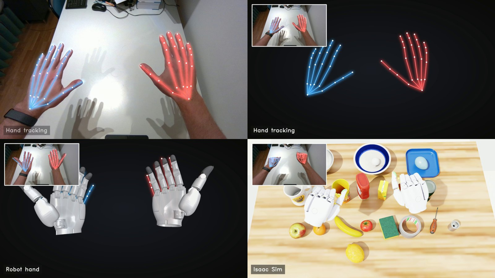
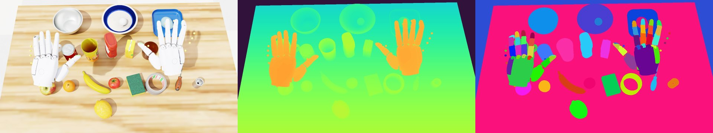
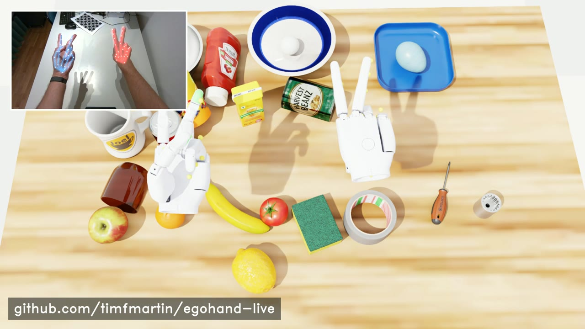

# egohand-live

**One camera instead of a VR headset: teleoperate robot hands in Isaac Sim, in real time, on a single laptop.**

[](https://github.com/timfmartin/egohand-live/actions/workflows/tests.yml)
[](LICENSE)

<!-- HERO VIDEO: edit this README on github.com, drag outputs/github_media/egohand-live_demo.mp4
     (8 MB, 1080p) onto this line, and keep the github.com/user-attachments/... link it inserts. -->



egohand-live runs NVIDIA's [EgoHand](https://github.com/NVIDIA/IsaacCapture/tree/main/src/python/isaaccapture_egopost)
hand-pose model live on a desk camera and streams both hands as the 26 OpenXR hand joints that
headset hand tracking produces. From there it is NVIDIA's standard path: retargeting to Sharpa
Wave robot hands (free-floating or on a Franka FR3 Duo), or gripper control in Isaac Lab tasks
with demonstrations recorded for robot learning.

## Why

Dexterous teleoperation, and collecting demonstrations for robot learning, usually means a
hand-tracking headset (Apple Vision Pro, Meta Quest) streaming into Isaac Lab through CloudXR, or
data gloves. egohand-live needs a camera on a desk stand and the GPU you already run Isaac Sim on.

- **Nothing to wear.** Sit down and move your hands over the desk.
- **Real time on one machine.** Tracking and Isaac Sim together on an RTX 3080 Ti laptop: ~65 ms
  from camera to robot hand, simulation at 1.0× real time.
- **Cheap and quick to set up.** A RealSense D405 or a webcam on a 3D-printed stand; a printed
  ChArUco board calibrates lens, camera pose and depth scale in a few minutes.
- **Headset-compatible output.** OpenXR hand joints, retargeted with the same DexPilot setup as
  NVIDIA Isaac Teleop's headset pipeline, so existing tooling applies.

Why a fixed camera works: EgoHand is trained on head-mounted (egocentric) video, so the
[desk stand](hardware/d405_desk_mount) puts the camera where your head would be, behind and above
your hands.

|  | Hand-tracking headset | egohand-live |
| --- | --- | --- |
| Hardware | €330 – €4,000 headset | webcam or D405 + printed stand |
| Operator | wears the headset | nothing to wear |
| View of the robot | immersive stereo | monitor |
| Hand pose | measured by the headset | estimated from one image: good finger shapes, calibrated depth (±3 %) |
| Compute | in the headset | the RTX GPU that runs Isaac Sim |

## What's in the box

- **Live hand tracking** (`egohand-live run`): RT-DETR detector, a causal left/right hand tracker,
  EgoHand (DINOv3 ViT-H+) in fp16 with CUDA graphs, One Euro smoothing; OpenXR-26 joints over
  ZeroMQ for any subscriber. ~16 FPS on an RTX 3080 Ti laptop, ~22 FPS on an RTX 5090 (two hands).
- **Camera setup tools**: live framing preview, lens calibration (checkerboard or ChArUco, fisheye
  model for wide lenses), camera pose from a board on the desk, monocular depth-scale calibration.
- **Isaac Sim / Isaac Lab scenes**: Sharpa Wave hands over a desk of NVIDIA SimReady props, the
  same hands on Franka's FR3 Duo, and an Isaac Lab driver for gripper tasks that records
  demonstrations in Isaac Lab's HDF5 format (GR00T-Mimic ready).
- **A 3D-printable desk stand** for the D405 (FreeCAD, STEP, STL).

## Isaac Teleop: standing in for the headset's hand tracking (in progress)

NVIDIA Isaac Teleop lets device plugins replace the headset's hand tracking: NVIDIA's Manus glove
plugin pushes OpenXR hand joints into the CloudXR runtime, and every consumer downstream uses them
instead of the headset's. An egohand-live plugin does the same with the camera's hands, so that
Isaac Lab's **hand-driven** teleoperation tasks run without code changes, viewed on a monitor
instead of a headset:

| Isaac Lab task | Input | With egohand-live |
| --- | --- | --- |
| GR1T2 pick-and-place, nut-pour, exhaust-pipe | hand tracking | planned, unchanged |
| Unitree G1 with Inspire hands | hand tracking | planned, unchanged |
| Galbot stacking (absolute mode) | hand tracking | planned, unchanged |
| Franka cube stacking | controllers (+ hands for the gripper) | via [`isaac/arm_teleop.py`](isaac/arm_teleop.py) today |
| SO-101 stacking, G1 locomanipulation | controllers | not supported (no controller emulation) |

It replaces hand tracking only, not motion controllers, head or body tracking. NVIDIA's CloudXR
runtime (installed with Isaac Lab's teleop extra, under NVIDIA's licence) still runs, without any
headset or XR client. Status: being validated.

## How it works

```
camera ──► RT-DETR hand detector ──► L/R hand tracker ──► EgoHand (DINOv3 ViT-H+) ──► smoothing
                                                                                        │
     Isaac Sim / Isaac Lab ◄── robot hands / arm + gripper ◄── retargeting ◄── OpenXR-26 hand joints (ZMQ)
```

EgoHand ships as an offline video pipeline. egohand-live wraps it for live use without modifying
it: per-frame inference of both hands, a causal tracker that assigns left and right by image
position (palm-up hands fool the detector's labels), a confidence filter against false detections,
and online smoothing. Details: [docs/tracking.md](docs/tracking.md) and
[docs/isaac_sim.md](docs/isaac_sim.md).



## Quick start

Tested on Ubuntu 24.04, Python 3.12, NVIDIA driver 595 (CUDA 13), Isaac Sim 6.2 / Isaac Lab 3.0,
on an RTX 3080 Ti laptop (everything on one machine) and with an RTX 5090 for tracking.

**1. Install hand tracking**

```bash
git clone https://github.com/timfmartin/egohand-live && cd egohand-live
bash scripts/setup.sh                     # pinned upstream EgoHand + dependencies + models (~12 GB)
source .venv/bin/activate
egohand-live slim-ckpt --out checkpoints/egohand_slim.ckpt   # optional: 3.5 GB instead of 10.7 GB, loads faster
```

**2. Set up the camera** (once per camera and placement; see [docs/tracking.md](docs/tracking.md#webcam-setup))

```bash
egohand-live preview --source webcam:0                        # aim the camera: work area in the middle
egohand-live calibrate-camera --source webcam:0 --board charuco:auto:27 --out outputs/cam.json   # lens
egohand-live calibrate-desk-board --source webcam:0 --intrinsics outputs/cam.json \
    --board charuco:auto:27 --out outputs/T_world_camera.txt  # camera pose: board flat on the desk
```

A RealSense needs no lens calibration (`--source realsense`). Any printed ChArUco board works
(27 = square size in mm), as does a checkerboard on a phone screen.

**3. Track**

```bash
egohand-live run --source webcam:0 --intrinsics outputs/cam.json --extrinsics outputs/T_world_camera.txt \
    --checkpoint checkpoints/egohand_slim.ckpt --compile --show --publish
egohand-live calibrate-depth --extrinsics outputs/T_world_camera.txt   # once: measures --depth-scale
```

**4. Robots in Isaac Sim** (same or another machine)

```bash
bash scripts/setup_isaac.sh               # Sharpa Wave models (pinned) + two small packages for Isaac Sim's Python
python3 scripts/fetch_simready.py         # desk props + Franka FR3 Duo (CC-BY-4.0, ~375 MB)
~/isaacsim/python.sh isaac/sharpa_hands.py --extrinsics outputs/T_world_camera.txt               # Sharpa hands
~/isaacsim/python.sh isaac/sharpa_hands.py --extrinsics outputs/T_world_camera.txt --rig franka  # on an FR3 Duo
~/isaacsim/python.sh isaac/arm_teleop.py --extrinsics outputs/T_world_camera.txt                 # Franka gripper, cube stacking
```

Add `--connect tcp://TRACKING_HOST:5555` when tracking runs elsewhere. The viewport renders in a
light mode by default so tracking keeps the GPU; `--render quality` gives full RTX.

**No camera?** `egohand-live synthetic --publish "tcp://*:5555"` streams moving, grasping
synthetic hands in the same format, enough to try the simulator side.

## Grippers and demonstrations

[`isaac/arm_teleop.py`](isaac/arm_teleop.py) drives Isaac Lab tasks with an end-effector pose
action and a gripper (default `IsaacContrib-Stack-Cube-Franka-IK-Abs`): the gripper follows the
point between your thumb and index fingertips, and pinching closes it (`--gripper continuous`
makes the opening follow the pinch width). `--record demos/stack.hdf5` saves successful episodes
with Isaac Lab's recorder, ready for `replay_demos.py` and GR00T-Mimic.

## Gallery

| Sharpa Wave hands on a Franka FR3 Duo | Free-floating Sharpa Wave hands |
| --- | --- |
|  |  |



## Results

| Measurement | Value |
| --- | --- |
| Tracking, RTX 3080 Ti laptop (1–2 hands) | 70 ms per frame (~14 FPS); 58–63 ms with `--compile` (~16 FPS) |
| Same laptop, with Isaac Sim (Sharpa hands) on the same GPU | sim at 1.0× real time, ~65 ms camera → robot hand |
| Tracking, RTX 5090 (two hands, earlier bf16 version) | ~22 FPS, 50 ms capture → poses |
| fp16 path vs. fp32 reference | 0.3–0.4 mm mean joint difference (bf16: 1.3 mm) |
| Monocular depth, D405 at 0.7–1.0 m / webcam at ~0.9 m | −10 % / −13 % before `--depth-scale`, ±3 % after |
| Retargeting (DexPilot, Sharpa Wave, 22 DoF) | 5–15 ms per hand |
| Arm IK error while following (FR3 Duo; Franka gripper task) | 5–20 mm |

## Hardware

The [D405 desk stand](hardware/d405_desk_mount) holds the camera on an 880 mm aluminium extrusion
clamped to the desk edge, with an adjustable tilt. Four printed parts, standard M3/M4/M5 screws.
FreeCAD source, STEP and STL files are included. A webcam can sit on the same stand.

## Limitations

- Needs an RTX-class GPU. On a laptop, the GPU and CPU are shared with Isaac Sim, so keep other
  heavy jobs off while teleoperating.
- Monocular depth: finger shapes are good; the absolute distance has a camera-specific bias that
  `calibrate-depth` corrects. Beyond ~1 m from the camera the error becomes random, so keep the
  camera within ~0.9 m of your hands.
- The camera should look over your shoulders at your hands; left and right are assigned by image
  position, which assumes this placement.
- A monitor instead of an immersive view; no force or haptic feedback.

## Roadmap

- Isaac Teleop plugin: camera hands in place of the headset's for hand-driven Isaac Lab tasks.
- Fuse the D405's depth for absolute wrist position.
- LeRobot export of recorded demonstrations; more Isaac Lab tasks.
- A humanoid rig (Unitree H2 with Sharpa hands).

## Repository layout

```
egohand_live/     live tracking, protocol, retargeting, calibration, gripper teleop math (CLI: egohand-live)
isaac/            Isaac Sim scenes: Sharpa hands, FR3 Duo rig, Isaac Lab gripper teleop, render presets
hardware/         3D-printable D405 desk stand (FreeCAD, STEP, STL)
configs/          DexPilot retargeting configs (from NVIDIA IsaacCapture)
scripts/          setup, asset download, upstream verification
tests/            GPU-free tests (run in CI)
docs/             tracking and Isaac Sim details, media
```

## Credits and licenses

- Code in this repository: [Apache-2.0](LICENSE).
- EgoHand / EgoPost and its model weights: NVIDIA,
  [OpenMDW-1.1](https://github.com/NVIDIA/IsaacCapture/blob/main/LICENSES/LicenseRef-OpenMDW-1.1.txt),
  part of [NVIDIA Isaac Capture](https://github.com/NVIDIA/IsaacCapture). Downloaded at a pinned
  commit by `scripts/setup.sh`, not redistributed.
- `configs/retarget/*.yml`: from NVIDIA Isaac Capture (Apache-2.0, © The Isaac Lab Project
  Developers). Retargeting uses [dex-retargeting](https://github.com/dexsuite/dex-retargeting).
- Sharpa Wave hand models: [Sharpa](https://github.com/sharpa-robotics/sharpa-urdf-usd-xml),
  downloaded at a pinned commit by `scripts/setup_isaac.sh`, not redistributed.
- Desk props: [NVIDIA SimReady assets](https://huggingface.co/datasets/nvidia/simready-assets);
  Franka FR3 Duo: [Franka Robotics SimReady assets](https://huggingface.co/datasets/frankarobotics/simready-assets).
  Both CC-BY-4.0, downloaded at pinned revisions by `scripts/fetch_simready.py`. The images in
  `docs/media` show these assets; the wood desk material is from NVIDIA's base material library.
- The gripper teleop task is Isaac Lab's (BSD-3-Clause), loaded from your Isaac Lab install.
