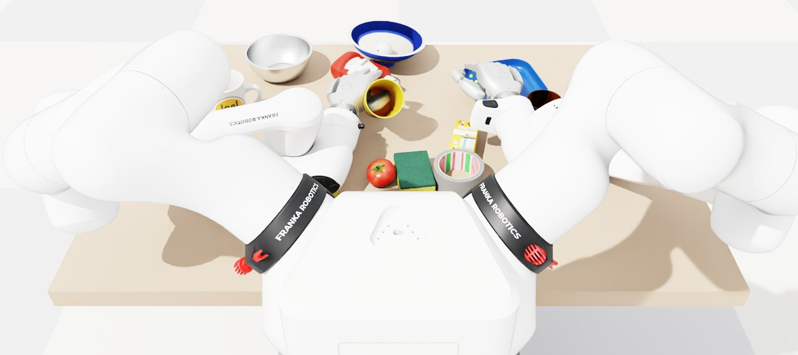

# egohand-live

**Teleoperate robot hands in Isaac Sim with one desk camera instead of a VR headset.**

egohand-live runs NVIDIA's [EgoHand](https://github.com/NVIDIA/IsaacCapture/tree/main/src/python/isaaccapture_egopost)
hand-pose model live on a camera stream and publishes both hands in 3D in the OpenXR hand-joint
format that headset hand tracking uses. Included Isaac Sim / Isaac Lab scenes retarget them to
Sharpa Wave robot hands, either free-floating or mounted on a Franka FR3 Duo, so the robot
hands follow yours.

| Sharpa Wave hands on a Franka FR3 Duo | Free-floating Sharpa Wave hands |
| --- | --- |
|  |  |

<!-- demo video: real hands next to the simulator -->

## Why

Teleoperating dexterous hands, for instance to collect demonstrations for robot learning,
usually requires a hand-tracking headset (Apple Vision Pro, Meta Quest) or data gloves.
egohand-live needs a camera and a 3D-printed desk stand, and runs on the kind of NVIDIA GPU you
already use for Isaac Sim.

- **Nothing to wear.** Sit down and move your hands over the desk; the camera can record the
  human view at the same time.
- **Low cost.** An Intel RealSense D405 (tested) or any calibrated UVC webcam, plus a stand made
  of printed parts, a 20 × 20 mm aluminium extrusion and standard screws.
- **Drop-in data.** The output follows the OpenXR hand-joint convention, and retargeting uses the
  same DexPilot setup as NVIDIA Isaac Teleop's headset pipeline.

Why one fixed camera works: EgoHand is trained on head-mounted (egocentric) video, so the
[desk stand](hardware/d405_desk_mount) puts the camera where your head would be, behind and
above your hands.

|  | Hand-tracking headset | egohand-live |
| --- | --- | --- |
| Hardware | €330 – €4,000 headset | camera + printed stand, on the GPU that runs Isaac Sim |
| Operator | wears the headset | nothing to wear |
| View of the robot | immersive stereo | monitor |
| Hand pose | measured by the headset's cameras | estimated from one image: good finger shapes, absolute depth within a few cm |
| Compute | in the headset | RTX-class GPU (RTX 5090: ~22 FPS for two hands) |

## How it works

```
camera ──► RT-DETR hand detector ──► L/R hand tracker ──► EgoHand (DINOv3 ViT-H+) ──► smoothing
                                                                                        │
            Isaac Sim / Isaac Lab ◄── robot hands / arms ◄── DexPilot retargeting ◄── OpenXR-26 hand joints (ZMQ)
```

EgoHand ships as an offline video pipeline (video in, poses out). egohand-live wraps it for live
use without modifying it: a causal hand tracker, per-frame batched inference of both hands,
online smoothing, and a ZeroMQ stream that other processes (the simulator, a viewer, your own
code) subscribe to. Details: [docs/tracking.md](docs/tracking.md) and
[docs/isaac_sim.md](docs/isaac_sim.md).

## Quick start

Tested on Ubuntu 24.04, Python 3.12, NVIDIA driver 595 (CUDA 13), with an RTX 5090 for tracking
and Isaac Sim 6.2 / Isaac Lab 3.0 on an RTX 3080 Ti laptop. Tracking and simulation can run on
the same machine or on two machines.

**1. Hand tracking** (machine with the GPU)

```bash
git clone https://github.com/timfmartin/egohand-live && cd egohand-live
bash scripts/setup.sh                     # pinned upstream EgoHand + dependencies + models (~12 GB)
source .venv/bin/activate
egohand-live slim-ckpt --out checkpoints/egohand_slim.ckpt   # optional: 3.5 GB instead of 10.7 GB, loads faster
egohand-live run --source realsense --checkpoint checkpoints/egohand_slim.ckpt --compile --show --publish
```

`--source webcam:0 --intrinsics cam.json` uses a UVC webcam instead; `--source video:clip.mp4`
replays a recording as if it were live.

**2. Robot hands in Isaac Sim** (machine with Isaac Sim)

```bash
bash scripts/setup_isaac.sh               # Sharpa Wave models (pinned) + two small packages for Isaac Sim's Python
python3 scripts/fetch_simready.py         # desk props + Franka FR3 Duo (CC-BY-4.0, ~375 MB)
~/isaacsim/python.sh isaac/sharpa_hands.py --connect tcp://TRACKING_HOST:5555 --rig franka
```

Leave out `--rig franka` for free-floating hands. Place the hands correctly with the camera pose:
`--extrinsics T_world_camera.txt` (see [Camera pose](docs/tracking.md#camera-pose)).

**No camera?** `egohand-live synthetic --publish "tcp://*:5555"` streams moving, grasping
synthetic hands in the same format, enough to try the simulator side.

## Hardware

The [D405 desk stand](hardware/d405_desk_mount) holds the camera on an 880 mm aluminium extrusion
clamped to the desk edge, with an adjustable tilt. Four printed parts, standard M3/M4/M5 screws.
FreeCAD source, STEP and STL files are included; `mount_geometry.py` turns the collar height and
tilt reading into the camera pose for the simulator.

## Results

| Measurement | Value |
| --- | --- |
| Tracking, RTX 5090 (two hands, bf16, `--compile`) | ~22 FPS; detector 5 ms, EgoHand 35 ms per frame |
| Camera capture → hand poses, RTX 5090 | 50 ms median |
| Camera (laptop) → 5090 → simulator (laptop), LAN | ~105 ms; ~17 updates/s reach the simulator |
| Everything on one RTX 3080 Ti laptop (tracking + Isaac Sim) | ~10 FPS, ~230 ms capture → poses (not optimised yet) |
| Retargeting (DexPilot, Sharpa Wave, 22 DoF) | 5–15 ms per hand |
| Robot vs. tracked fingertips | 1–4 cm |
| FR3 Duo wrist IK error while following (synthetic hands) | 5–15 mm |

## Limitations

- Needs an RTX-class GPU; on a laptop GPU shared with Isaac Sim, latency is high.
- Monocular depth: finger shapes are good, but the absolute hand position can be off by a few
  centimetres, more for hands far from the camera.
- The viewpoint matters: the camera should look over your shoulders at your hands. Left and right
  are assigned by image position, which assumes this placement.
- A monitor instead of an immersive view; no force or haptic feedback.

## Roadmap

- Validate a low-cost webcam end to end, with a camera-calibration command and a tripod-screw cradle.
- Fuse the D405's depth for absolute wrist position.
- An Isaac Teleop device plugin, so Isaac Lab's existing headset teleoperation tasks run unchanged
  with a camera.
- A humanoid rig (Unitree H2 with Sharpa hands).
- Episode recording in LeRobot format for VLA data collection.

## Repository layout

```
egohand_live/     live tracking, protocol, retargeting, calibration, synthetic hands (CLI: egohand-live)
isaac/            Isaac Sim scenes: Sharpa hands, FR3 Duo rig, SimReady desk
hardware/         3D-printable D405 desk stand (FreeCAD, STEP, STL)
configs/          DexPilot retargeting configs (from NVIDIA IsaacCapture)
scripts/          setup, asset download, upstream verification
tests/            GPU-free tests (run in CI)
docs/             tracking and Isaac Sim details
```

## Credits and licenses

- Code in this repository: [Apache-2.0](LICENSE).
- EgoHand / EgoPost and its model weights: NVIDIA,
  [OpenMDW-1.1](https://github.com/NVIDIA/IsaacCapture/blob/main/LICENSES/LicenseRef-OpenMDW-1.1.txt),
  part of [NVIDIA Isaac Capture](https://github.com/NVIDIA/IsaacCapture). Downloaded at a pinned
  commit by `scripts/setup.sh`, not redistributed.
- `configs/retarget/*.yml`: from NVIDIA Isaac Capture (Apache-2.0, © The Isaac Lab Project
  Developers). Retargeting uses [dex-retargeting](https://github.com/dexsuite/dex-retargeting).
- Sharpa Wave hand models: [Sharpa](https://github.com/sharpa-robotics/sharpa-urdf-usd-xml),
  downloaded at a pinned commit by `scripts/setup_isaac.sh`, not redistributed.
- Desk props: [NVIDIA SimReady assets](https://huggingface.co/datasets/nvidia/simready-assets);
  Franka FR3 Duo: [Franka Robotics SimReady assets](https://huggingface.co/datasets/frankarobotics/simready-assets).
  Both CC-BY-4.0, downloaded at pinned revisions by `scripts/fetch_simready.py`. The screenshots
  in `docs/media` show these assets.
