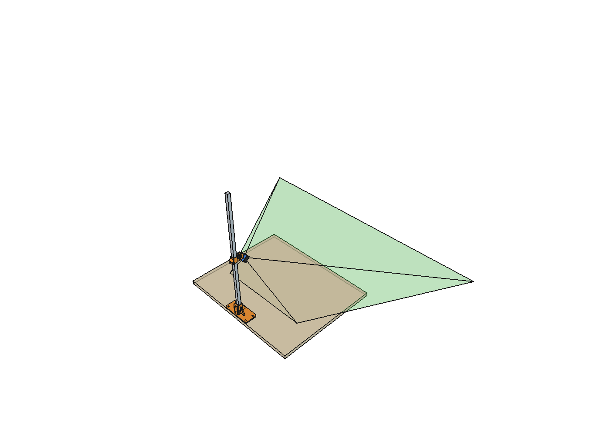
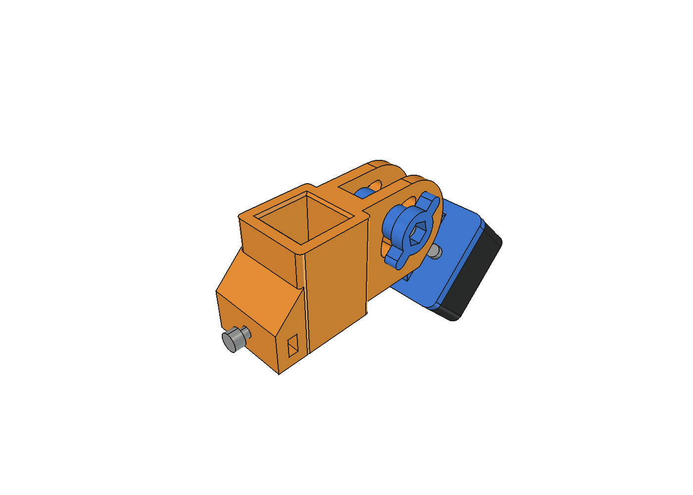
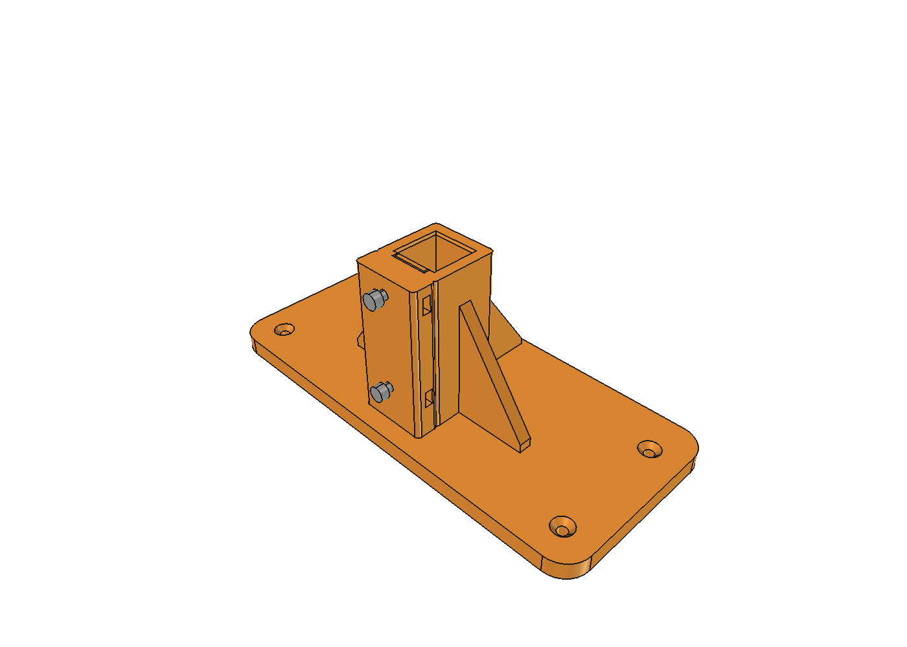
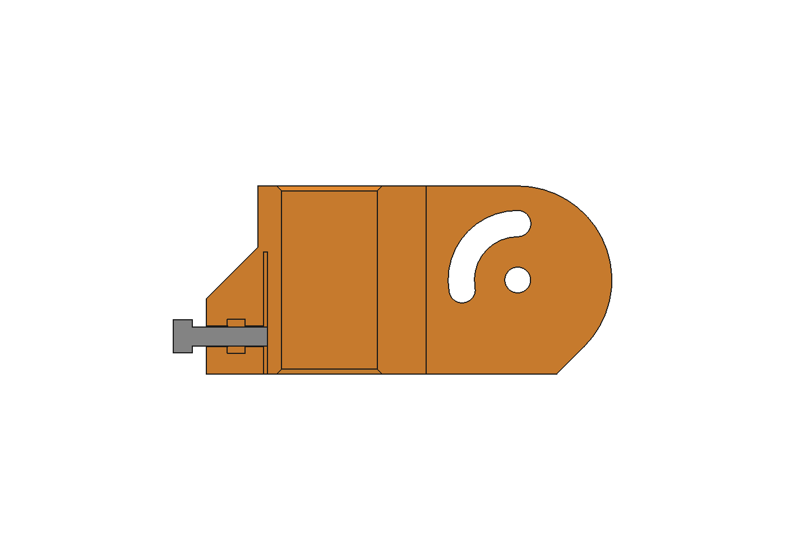
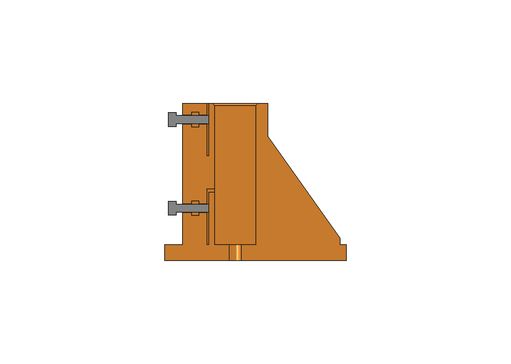

# RealSense D405 desk mount

A 3D-printed stand that holds an Intel RealSense D405 above a desk on a 20 × 20 mm
aluminium extrusion (B-type, 6 mm slot). It films your hands from behind and above, the
way a head-mounted camera would, for `egohand-live`. You stand behind the bar, reach
around it, and work on the desk in front of it.



Four printed parts:

| Part | File | Print size (mm) | What it does |
|---|---|---|---|
| Desk foot | `stl/desk_foot.stl` | 200 × 90 × 78 | Socket for the bar (70 mm deep) on a plate you clamp to the desk edge |
| Camera clamp | `stl/cam_clamp.stl` | 30 × 86 × 40 | Slides onto the bar at any height; the fork on the front carries the tilt joint |
| Camera cradle | `stl/cam_cradle.stl` | 42 × 42 × 51 | D405 back plate (2× M3) with the tongue that sits in the fork |
| Tilt knob | `stl/tilt_knob.stl` | 28 × 16 × 11 | Wing knob for a normal M5 nut; locks the tilt angle |

| Camera head (45° tilt) | Desk foot |
|---|---|
|  |  |

## How it works

- **Bar lock:** each bore is 20.4 mm square. On the back face of each bore, a 16 × 3 mm
  pad is cut free from the wall on three sides, printed in one piece with the part. An
  M4×16 screw (with an M4 nut in a side slot) presses the pad onto the flat back face of
  the bar. The pad spans the 6 mm slot and bears on both lips, and it pushes the bar flat
  against the opposite wall, so there's a large contact area and no play whatever your
  printer's tolerance. The camera clamp has one pad. The foot has two, one low and one
  high in the socket, so the bar can't wobble.

  | Camera clamp cut-away | Foot cut-away |
  |---|---|
  |  |  |

- **Tilt:** an M5 pivot bolt, plus a second M5 lock bolt that runs in an arc slot, hold the
  camera anywhere from −10° (looking slightly up) to 90° (straight down). Set the pivot nut
  snug once with tools. To change the angle you only loosen the wing knob. The scale on the
  left cheek has a tick every 15°, with long ticks at 0°, 45° and 90°. Read it at the
  centre of the lock bolt. The number is the camera's pitch below horizontal.
- **Desk:** the flat wings (|x| ≥ 55 mm from the bar) are left clear for two F-clamps or
  C-clamps. For a permanent setup there are also four countersunk holes for 4 mm wood screws.

## Hardware

| Qty | Part | Used for |
|---|---|---|
| 3 | M4×16 screw | bar locks (1 clamp, 2 foot) |
| 3 | M4 hex nut | in the bar-lock nut slots |
| 2 | M5×30 bolt | tilt pivot + tilt lock (M5×35 also works) |
| 2 | M5 hex nut | pivot nut, and the nut inside the printed tilt knob |
| 1 | M5 washer | under the lock bolt head, on the slot side |
| 2 | M3×8 screw | D405 to cradle. **Use nothing longer than M3×9**: the camera's M3 threads are only 4 mm deep, and M3×8 through the 5 mm plate engages 3 mm |
| 1 | 20 × 20 aluminium extrusion, 880 mm | |
| 2 | desk clamps | |

## Printing

- Use PETG, ASA or ABS. PLA works, but it slowly creeps under the constant screw load.
  Being stiffer, PLA is also a little worse for the flexible pads.
- Settings: 0.2 mm layers, 4 walls, 5 top/bottom layers, 30–40 % gyroid infill.
- No supports. The STLs are already in print orientation:
  - the foot and clamp stand as used
  - the cradle prints with the camera face on the bed
  - the knob prints with its wings on the bed

  The only overhangs are short bridges over the holes, the nut slots, the tilt slot and
  the slits around the pads.
- After printing, check that each pad moves freely. If a slit has fused shut, run a thin
  blade through it.
- The M5 nut should push firmly into the knob's hex pocket. If it's loose, add a drop of glue.
- If the bar doesn't slide into the clamp, raise `BAR_CLR` in `mount_geometry.py` and
  rebuild (see below). The pads take up any extra play.

## Assembly

1. **Nuts:** slide an M4 nut into each side slot of the rear lock blocks: two on the foot,
   one on the clamp. Thread an M4×16 in from the back until it catches the nut. Don't touch
   the pad yet.
2. **Foot:** push the bar into the foot until it sits on the plate, then tighten both lock
   screws. The small hole under the socket lets air out, and lets you push the bar back out.
3. **Desk:** put the foot's rear edge (the side with the lock screws) flush with the desk
   edge on your side, and clamp both wings.
4. **Camera:** screw the D405 to the cradle with 2× M3×8, logo upright and the USB port on
   the left as seen from behind. The extrinsics below assume this orientation.
5. **Clamp:** slide the camera clamp down over the top of the bar, with the fork facing the
   same way as the foot's front fin and the lock screw at the back, like on the foot. Set
   the height and tighten the screw.
6. **Tilt joint:** put the cradle tongue into the fork.
   - **Pivot:** an M5×30 through the hole at the centre of the round end of the fork. The
     head goes on the right, the nut on the left. Tighten it until the tilt is stiff but
     still moves.
   - **Lock:** a second M5×30 with the washer under its head, from the left, through the
     arc slot and the tongue's rear hole. Push the M5 nut into the knob and screw the knob
     on from the right.
   - Set the angle on the scale and tighten the knob.
7. Run the USB cable down the bar with cable ties, or press it into the bar's slot.

## Height and angle for the D405

The D405 is a short-range camera: its depth works best from 7 to 50 cm. `egohand-live`
only uses the colour stream, so longer distances still work, but your hands get smaller
in the image and less sharp. Keep the camera **about 40–60 cm from your hands**. With the
camera at the top of the 880 mm bar, your hands are about 1 m away, which is too far.

The table assumes the foot's rear edge is at the desk edge. "Collar" is the height from
the desk surface to the bottom face of the camera clamp. The y values are distances in
front of the bar.

| Collar (mm) | Tilt | Lens height | Optical axis meets desk at | Lens → that point | Visible desk (y) |
|---|---|---|---|---|---|
| 300 | 45° | 284 | 360 | 401 | 158 – 1066 |
| 300 | 55° | 278 | 264 | 339 | 99 – 639 |
| 415 | 45° | 399 | 475 | 564 | 191 – 1467 |
| **415** | **55°** | **393** | **345** | **480** | **111 – 875** |
| 415 | 65° | 389 | 243 | 429 | 35 – 596 |
| 550 | 55° | 528 | 439 | 645 | 125 – 1152 |
| 800 | 55° | 778 | 614 | 950 | 151 – 1665 |

A collar height of about 415 mm with a 50–60° tilt is a good starting point. The camera
clamp can go anywhere on the bar, so you can keep the full 880 mm bar or cut it to about
600 mm.

## Camera pose for egohand-live

`mount_geometry.py` computes `T_world_camera` from the collar height and the tilt reading:

```bash
python3 hardware/d405_desk_mount/mount_geometry.py --collar-height 415 --tilt 55 > T_world_camera.txt
egohand-live run --source realsense --publish tcp://*:5555 --extrinsics T_world_camera.txt
```

- **World frame:** origin on the desk surface directly under the bar axis. +x is to the
  operator's right, +y points away from the operator (the direction the camera looks), and
  +z is up. The translation is in metres.
- **Camera frame:** RealSense/OpenCV optical frame (x right, y down, z forward). Its origin
  is the D405 left imager, which is the origin of both the colour and depth streams. That
  imager is 9 mm left of centre and 3.7 mm behind the front glass (datasheet tables 4-17 and
  4-22).
- **Accuracy:** expect a few mm and about 1° when you set the tilt from the engraved scale.
  This is fine for teleoperation. If you need better, calibrate against a marker on the desk.

## Changing the design

Every dimension lives in `mount_geometry.py`. To rebuild with FreeCAD 1.x:

```bash
cd hardware/d405_desk_mount
freecadcmd build_mount.py
```

The script regenerates `stl/`, `step/` and `d405_desk_mount.FCStd` (the full assembly in
the preview pose, with a D405 stand-in, the screws, a desk and the camera's field of view).
It also prints a set of checks:
- whether each part is a valid solid
- whether the bar fits both bores
- a collision sweep of the cradle, camera, lock bolt and wing knob (in every wing
  position) against the clamp, the pivot bolt and the bar over the full tilt range. The
  current design has no overlap, and at least 2.4 mm of clearance at the camera.
- whether the M5×30 bolts are long enough
- where the M4 lock screws meet their nuts and pads

If you run it headless, the `.FCStd` has no part colours. Run it from the FreeCAD GUI's
Python console to keep them:
`exec(open(p).read(), {"__file__": p})` with `p` set to the script path.

D405 dimensions come from Intel RealSense D400 Series datasheet 337029-017 (Fig. 10-14,
Table 3-54): body 42 × 42 × 23 mm, 58 g, 2× M3×0.5 on the back 20 mm apart (max 4 mm deep),
1/4-20 tripod thread underneath, micro-USB on the left side.
